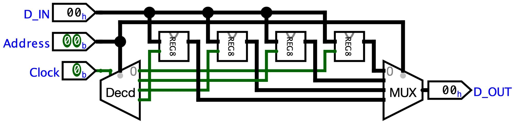

# Static RAM of Four 8-bit Words

A static memory that stores four 8-bit words, built from the bottom up out of NAND gates. A 2-bit `Address` picks the
word, a pulse on `Clock` writes `D_IN` into it, and `D_OUT` always shows the word at `Address`.

## How It Works

1. **`RS_TRIGGER`** is a gated SR latch made of four NAND gates. The first two let `S` and `R` through only while
   `Clock` is 1, and the two cross-coupled ones hold the bit `Q`. Its next state is $Q^+ = SC + Q\overline{RC}$, and
   `S = R = 1` with `Clock = 1` is forbidden.
2. **`D_TRIGGER_RS`** feeds `D` to `S` and `NOT D` to `R`, so the forbidden case can't happen. While `Clock` is 1 the
   output copies `D`, and while it is 0 it keeps the last value, $Q^+ = Q\overline{C} + DC$.
3. **`REG4`** is four D triggers on the same clock, so the four bits are written at once. Bit 0 is the rightmost trigger.
4. **`REG8`** is two `REG4`, bits 3–0 on the right and bits 7–4 on the left.
5. **`SRAM4x8`** has four `REG8`, word 0 on the right. A 2-to-4 decoder enabled by `Clock` sends the clock pulse only
   to the register at `Address`, and a 4-input multiplexer on the same `Address` puts that register on `D_OUT`.

The triggers are level-sensitive, not edge-triggered, so change `Address` and `D_IN` only while `Clock` is 0.
Otherwise the new value is also written into the new address.

## Files

| File | What it is |
|---|---|
| `mem.circ` | Circuits `SRAM4x8` (main), `REG8`, `REG4`, `D_TRIGGER_RS` and `RS_TRIGGER`, each built from the next one. |

## Getting Started

Open `mem/mem.circ` in Logisim-evolution 4.1.0 or later. The `SRAM4x8` circuit loads first. Pick the Poke tool (the
hand), set `Address` and `D_IN`, then click `Clock` to 1 and back to 0 to write. Change `Address` with `Clock` at 0 to
read the other words.
