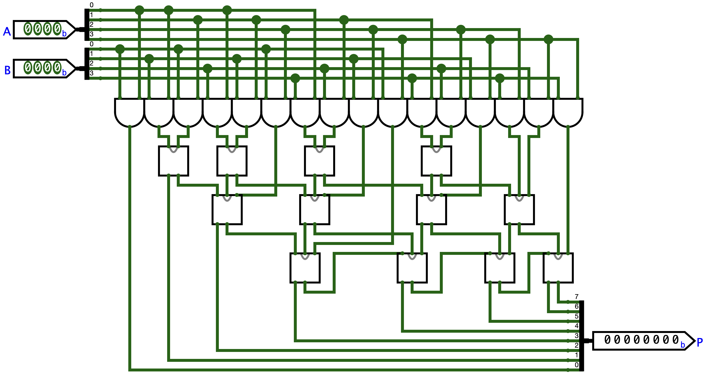

  # Binary multipliers

  

Combinational multipliers built gate by gate: an unsigned 2×2 multiplier, a signed 2×2 multiplier in two's complement with a mode selector, a signed 3×3 version built from shared signals and an unsigned 4×4 array multiplier.

## How It Works

1. **2×2 unsigned** (`mult`). Each product bit comes from its own Karnaugh map: $P_3 = XY$, $P_2 = \overline{X}Y$, $P_1 = b_1a_0 \oplus b_0a_1$ and $P_0 = X$, with $X = b_0a_0$ and $Y = b_1a_1$.
2. **2×2 signed** (`mult_sgn`). Same idea with $A$, $B$ and $P$ in two's complement. Only $P_3$ and $P_2$ change, since the two low bits of a product don't depend on the sign.
3. **Mode selector** (`op`). The input `sgn` picks the unsigned product (`sgn = 0`) or the signed one (`sgn = 1`), a 2-to-1 multiplexer per bit.
4. **3×3 signed** (`mult_3x3_sgn`). The same recipe with six-variable Karnaugh maps. Inputs go from −4 to 3 and the product from −12 to 16, so it needs 6 bits. $P_1$ and $P_0$ are again the unsigned ones, and $P_5$ is the sign bit. The partial products $b_ja_i$ and a few sums of bits are computed once in `vars_3x3_sgn` and shared by several outputs.
5. **4×4 unsigned** (`mult4`). Long multiplication in hardware. Sixteen AND gates make the partial products $a_ib_j$, a row of half adders and a row of full adders add them column by column (carry-save), and a ripple-carry row of full adders gives $P_3$ to $P_7$.

## Files

### [`mult.circ`](mult.circ)

| Circuit | What it is |
|---|---|
| `main` | Showcase of the unsigned 2×2 multiplier. Sixteen `mult` instances fed by constants, one per pair $(A, B)$. |
| `mult` | Unsigned 2×2 multiplier, inputs `A[2]`, `B[2]`, output `P[4]`. |
| `mult_sgn` | Signed 2×2 multiplier in two's complement, inputs `A[2]`, `B[2]`, output `P[4]`. |
| `op` | Mode selector. Inputs `A`, `B` and `sgn`, output `P`. A decoder turns `sgn` into two 4-bit masks that let through either `mult` or `mult_sgn`. |
| `two_1`, `two_2` | `mult` and `mult_sgn` side by side on the same inputs, used by `check`. They differ only in pin order. |
| `check` | All sixteen pairs at once. For each pair the top output is the unsigned product and the bottom one the signed product. |
| `mult_3x3_sgn` | Signed 3×3 multiplier in two's complement, inputs `A[3]`, `B[3]`, output `P[6]`. It builds each bit from the shared signals of `vars_3x3_sgn`. |
| `vars_3x3_sgn` | The signals that `mult_3x3_sgn` reuses, the partial products $b_ja_i$ and the sums and products of a few input bits. They are computed once and shared by several output bits. |
| `HA` | Half adder, $s = a \oplus b$, $c = ab$. |
| `FA` | Full adder built from two `HA` and an OR gate. |
| `mult4` | Unsigned 4×4 array multiplier, inputs `A[4]`, `B[4]`, output `P[8]`. |
| `mult4_HA` | Another 4×4 multiplier with the same adders, reduced column by column. Also correct. |

### [`vectors/`](vectors)

Logisim test vectors (`Simulate → Test Vector`). Each file names the pins in its header, with the width in brackets.

| File | Circuit | Cases |
|---|---|---|
| `m.txt` | `mult` | 16 |
| `sgn.txt` | `mult_sgn` | 16 |
| `op.txt` | `op` | 32 (16 per mode) |
| `sgn-3.txt` | `mult_3x3_sgn` | 64 |
| `m4.txt` | `mult4` | 256 |

## Getting Started

Open `mult/mult.circ` in Logisim-evolution 4.1.0 or later. The `main` circuit loads first and shows the sixteen unsigned 2×2 products. To try other inputs, open a circuit from the list above, pick the Poke tool (the hand) and click the input bits. To run a test, open the circuit, go to `Simulate → Test Vector`, and load the matching file from `vectors/`.
